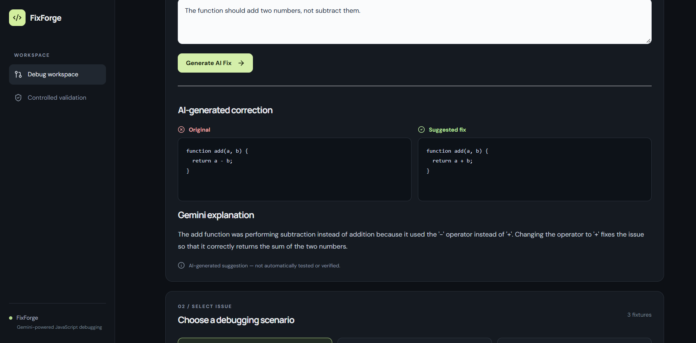
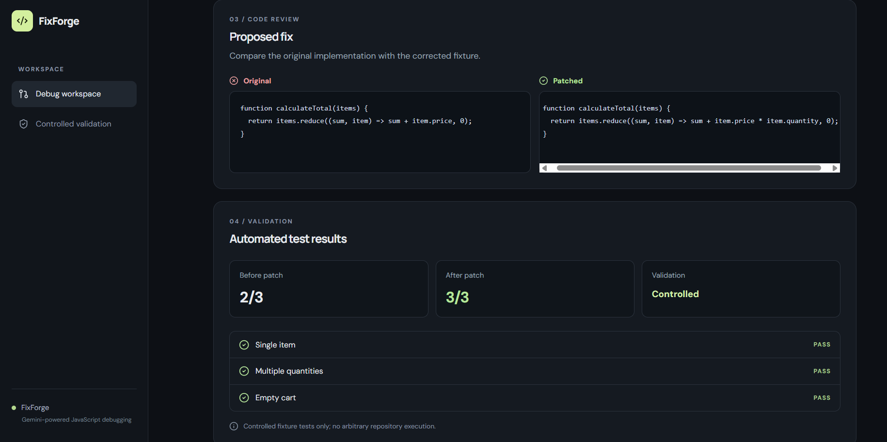

# FixForge

### AI-Assisted JavaScript Debugging & Code Correction

FixForge is a full-stack JavaScript debugging assistant built with **React, Node.js, and Express**, integrating **Google Gemini** to generate suggested code corrections and explain bugs.

It combines AI-assisted code fixing with reproducible debugging scenarios and controlled automated testing, helping developers review proposed changes and understand their impact.

## Preview



## Features

### AI-Assisted Code Fixing

- Submit custom JavaScript code along with a description of the bug.
- Generate a suggested correction using the Gemini API.
- Compare original and AI-generated code side by side.
- View explanations describing the bug and proposed solution.
- Review suggested fixes without automatically executing or applying them.



### Controlled Debugging & Validation

- Explore three predefined JavaScript debugging scenarios covering cart calculations, user filtering, and pagination.
- Compare original implementations with pre-reviewed corrections.
- Run three automated fixture tests per scenario.
- Examine before-and-after test results and individual test outcomes.
- View Gemini-generated root-cause explanations, with a local fallback when unavailable.


### Additional Features

- Responsive, dark-themed debugging workspace.
- REST API with input validation and error handling.
- Environment-based Gemini API configuration.
- Request timeout handling for external AI calls.

## Tech Stack

| Component | Technologies |
|---|---|
| Frontend | React, Vite, JavaScript, CSS |
| Backend | Node.js, Express |
| AI Integration | Google Gemini API |
| Testing | Node.js, controlled fixture tests |
| Version Control | Git, GitHub |

## Architecture

FixForge provides two independent debugging workflows.

**AI-Assisted Code Fixing**

```text
JavaScript code + bug description
               |
               v
          React frontend
               |
               v
          Express API
               |
               v
           Gemini API
               |
               v
   Suggested fix + explanation
               |
               v
       Code comparison UI
```

**Controlled Scenario Validation**

```text
       Predefined bug scenario
                 |
                 v
        Controlled test engine
                 |
                 v
      Before/after test results
                 |
                 v
      Gemini / local explanation
                 |
                 v
            React frontend
```

Custom Gemini-generated fixes are suggestions and are not automatically validated. Automated tests run only against predefined, developer-authored fixtures.

## Getting Started

### Prerequisites

- Node.js 20+
- npm
- Google Gemini API key for AI functionality

### Installation

Clone the repository:

```bash
git clone https://github.com/YOUR_USERNAME/FixForge.git
cd FixForge
```

Install dependencies:

```bash
npm install
npm run install:all
```

### Environment Configuration

Create the backend environment file.

**Windows PowerShell:**

```powershell
Copy-Item server/.env.example server/.env
```

**Windows Command Prompt:**

```cmd
copy server\.env.example server\.env
```

Configure `server/.env`:

```env
GEMINI_API_KEY=your_api_key_here
GEMINI_MODEL=your_supported_gemini_model
```

### Run Locally

```bash
npm run dev
```

- **Frontend:** http://localhost:5173
- **Backend:** http://localhost:4000

## API Reference

| Method | Endpoint | Description |
|---|---|---|
| `GET` | `/api/health` | Check backend availability |
| `GET` | `/api/scenarios` | Retrieve predefined debugging scenarios |
| `POST` | `/api/analyze` | Analyze and validate a predefined scenario |
| `POST` | `/api/fix` | Generate an AI-suggested correction for custom JavaScript |

### Example: AI Code Fixing

**Request:** `POST /api/fix`

```json
{
  "code": "function add(a, b) { return a - b; }",
  "issue": "The function should add two numbers, not subtract them."
}
```

**Example successful response:**

```json
{
  "mode": "gemini",
  "originalCode": "function add(a, b) { return a - b; }",
  "fixedCode": "function add(a, b) { return a + b; }",
  "explanation": "The function uses subtraction instead of addition. Replacing the subtraction operator with addition corrects the behavior.",
  "verified": false
}
```

AI-generated responses may vary.

## Testing

Run the project tests:

```bash
npm test
```

Build the frontend:

```bash
npm --prefix client run build
```

Each predefined debugging scenario contains three automated fixture tests. These tests evaluate known implementations and their pre-reviewed corrections.

**Note:** Test results from predefined scenarios do not represent the accuracy of Gemini-generated fixes for arbitrary user code.

## Limitations & Security

FixForge is an AI-assisted debugging tool, not an autonomous repository-repair agent.

- AI-generated fixes are not automatically executed, tested, or applied.
- Automated validation is limited to developer-authored debugging scenarios.
- The application does not clone repositories, create pull requests, or autonomously resolve GitHub issues.
- The controlled fixture engine uses Node.js `vm`, which is not a security boundary and must not be used to execute untrusted code.
- AI functionality depends on Gemini API availability and rate limits.

---

**FixForge — Debug with clarity.**
